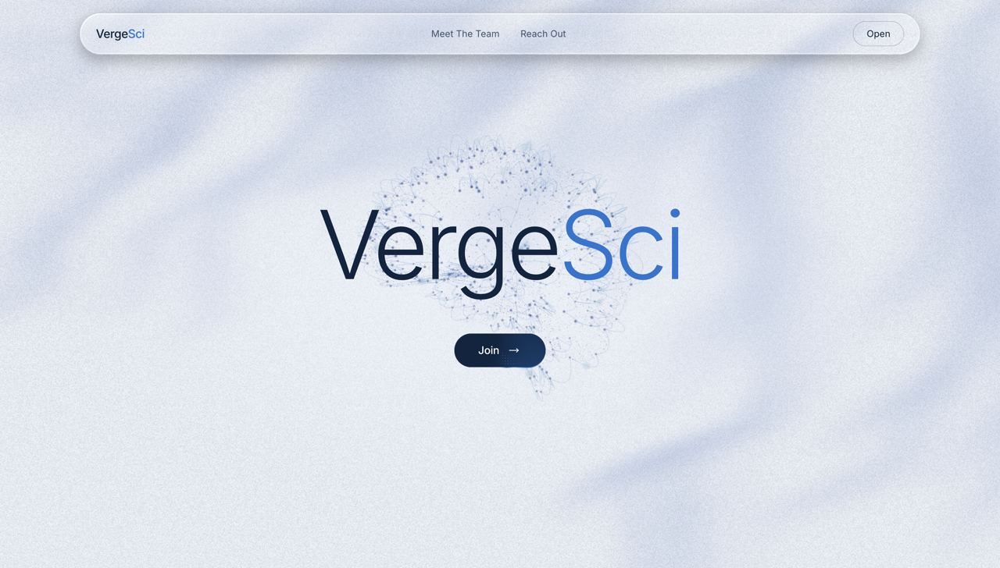

# VergeSci

**Making university research accessible to the students who want in.**

[vergesci.com](https://vergesci.com)

> **Note on the source code.** This repository is documentation only. The VergeSci
> platform is a private, closed-source codebase owned by VergeSci Labs and is not
> published here. This README explains what we build, how the matching and
> recommendation systems work, and where the product stands today. Happy to walk
> through the implementation in detail on a call.

---

## What VergeSci does

University research runs on who you happen to know.

A first-year who wants to work in a lab is told to "email professors." So they open
a department directory of several hundred names, read faculty pages written for other
faculty, guess which three sound closest to what they care about, and send cold emails
into a void. Most never hear back. The students who do land positions are
overwhelmingly the ones who already had a connection: a parent in academia, an older
sibling who did it last year, a TA who made an introduction. Research experience is
the single biggest gate on graduate admissions, medical school, and science careers,
and access to it is distributed almost entirely by social capital.

Meanwhile the information that would answer the student's question already exists in
public. Faculty research summaries, publication records, and federal grant abstracts
are all out there. They are just scattered across thousands of department pages,
written in language built for peers, and effectively unsearchable by an
eighteen-year-old who does not yet know the vocabulary of the field.

**VergeSci closes that gap.** We build a per-campus research graph from public data,
then use it to put the right faculty, labs, and open positions in front of each
student based on what they are actually interested in and what they have actually
done, not who they know.

### Who it serves

| | |
|---|---|
| **Undergraduates and master's students** | Find faculty whose current work genuinely matches their interests, see what each lab is working on right now in plain language, and reach out with context instead of a cold email. |
| **Principal investigators** | Post research positions and see ranked, interest-matched students from their own campus, instead of fielding hundreds of untargeted emails each term. |
| **Graduate students and postdocs** | Discover collaborators, labs, and departmental seminars across their institution. |
| **Universities** | A campus-scoped view of research participation, including which students are looking, which fields are oversubscribed, and where undergraduate research access is thinnest. |

Each campus is a closed loop. A student at one university sees that university's
faculty, that university's positions, and that university's students. Every campus
runs on its own isolated database cluster, so no institution's user data is
co-mingled with another's.

---

## Demo

A two and a half minute walkthrough of the real product: a student searches in plain
language, gets ranked faculty with current-work summaries, contacts a lab, browses
open research positions, and builds out a profile and project portfolio.

[](docs/demo/vergesci-demo.mp4)

<sub><b>▶ Click the image to play</b> (2:28, no audio). Direct link:
<a href="docs/demo/vergesci-demo.mp4">docs/demo/vergesci-demo.mp4</a><br>
Recorded against live production data, so student names and photos are blurred.
Faculty profiles are public information and are shown as they appear on the
platform.</sub>

---

## How recommendations work

Recommendations are built on dense vector retrieval over a per-campus corpus, then
reranked with a cross-encoder and adjusted by observed behavior. Three ingredients
go in: what the student says, what the faculty actually do, and what the student
does on the platform.

The architectural decision that matters most here is **where fresh behavior enters
the pipeline**. We run a two-speed system: a slow, stable student embedding that
determines the candidate set, and a fast, per-request reranking layer where
interaction signals actually do their work.

### 1. The student side: a deliberately slow vector

Every student gets a single embedding built from a weighted text representation of
who they are. The weighting is deliberate, because stated interests and revealed
interests are not equally informative:

- **Tier 1, active research queries (3x weight).** Every semantic search a student
  runs is captured to their profile, capped at the twenty most recent. These are the
  strongest available signal of real intent, so the deduplicated recent queries are
  placed first in the profile text and repeated three times to dominate the
  embedding.
- **Tier 2, engaged-lab research text (2x weight).** The research text of the top
  five labs a student has actually engaged with, by summed interaction weight, is
  folded in at double weight.
- **Tier 3, declared profile (1x weight).** Research interest statement, major and
  minors, intended degree, coursework, relevant skills, prior research experience,
  career aspirations, availability and commitment length, funding status, and parsed
  CV text.

The result is embedded with OpenAI `text-embedding-3-small` into a 1536-dimensional
vector. Critically, **it is not rebuilt on every interaction.** See
[when to re-embed](#2-when-to-re-embed-and-why-almost-never) below for why that
would be wasted work.

### 2. When to re-embed, and why almost never

The first version of this system regenerated a student's embedding after every
single search. That is the obvious design, and it is the wrong one.

**The retrieval layer only has to be right about the candidate set, not the order.**
The student vector's entire job is to pull a pool of plausible faculty out of a
campus corpus. The cross-encoder then re-sorts that pool from scratch. So the only
question worth asking about embedding freshness is: *how much new signal does it
take to change which faculty are in the pool?*

The answer is: far more than one interaction. A student's profile text runs around
2,000 tokens. One new query line, even at 3x weighting, adds roughly 45 tokens, about
2% of the total mass. Appending 2% more text to a document leaves the old and new
embeddings at a cosine similarity above 0.99. Against a campus corpus of one to three
thousand faculty, with the candidate pool deliberately over-fetched, a perturbation
that small reshuffles near-ties *inside* the pool and essentially never changes
membership. We were paying a full profile read, a roughly 7,000-token embedding call,
and a 6 KB vector write to produce a reordering the reranker was about to discard and
redo anyway.

So re-embedding is gated on a threshold:

> **Re-embed when the cumulative weight of un-embedded interaction signals reaches
> 3.0**, with a 24-hour minimum spacing between rebuilds and a 14-day flush for any
> student carrying pending signal below the threshold.

**Why trigger on weight rather than event count.** The interaction weights (table
below) already encode how informative each action is. A raw count would let thirty
profile views at 0.10 each, which is close to noise, force a rebuild, while a single
sent message at 1.00, the strongest preference signal in the system, would not.
Weight is the quantity we actually care about, so it is the quantity we threshold on.

**Why 3.0 specifically.** It is the point where the new text becomes large enough to
move the candidate set rather than just its internal ordering. Three units of weight
is roughly four searches, or one realistic mixed session: a contact click (0.80), two
saves (1.00), and three card clicks (0.90). At 3x query weighting that is on the order
of 120 to 180 tokens of new high-weight text, call it 6 to 9% of profile mass, which
is where new faculty genuinely start entering the top-k. Below that we are buying
noise; above it we are leaving real drift on the table.

It also maps onto a natural human unit. Three units of weight is about **one engaged
browsing session**, so a student's slow vector updates roughly once per session
instead of fifteen times within one. That drops re-embeds from O(searches) to
O(sessions), a five to tenfold reduction for an active user, and the cost scales with
genuine interest change rather than with raw clicking.

**Why the two guardrails.** The 24-hour spacing stops one unusually heavy session
from triggering repeated rebuilds as it crosses the threshold again and again. The
14-day flush catches the opposite failure: the light browser who never accumulates
3.0 but whose interests have still drifted over a term, and who would otherwise be
served against a vector built during onboarding.

There is a user-facing benefit too, not just a cost one. A feed that re-sorts itself
after every click feels broken; students lose their place and stop trusting that the
ranking means anything. Pinning the retrieval layer and letting only the reranker
move keeps results stable between sessions while staying responsive within one.

### 3. The faculty side

Every faculty member in a campus corpus gets an embedding built from name, title,
department, areas of research, and an LLM-generated research summary. Faculty who
match active federal awards also get a grant-enriched embedding (see
[research freshness](#the-research-freshness-challenge) below).

### 4. Retrieval, then reranking

**Step one, approximate nearest neighbor search (the slow layer).** The student
vector is queried against the campus faculty index using MongoDB Atlas Vector Search
(HNSW), returning candidates ranked by **cosine similarity** between the student
embedding and each faculty embedding. Open positions and other students are retrieved
the same way against their own indexes.

We deliberately **over-fetch**, pulling a top-k several times larger than what gets
displayed. Over-fetching is what makes a slow embedding safe: the right faculty member
only has to make it *into* the pool, and a stale-by-one-session vector is more than
good enough for that. Where the pool gets ordered is the next step.

**Step two, signal-informed cross-encoder rerank (the fast layer).** This is where
interaction signals enter, per request, at zero embedding cost:

1. **The rerank query is built from live signal state.** For an explicit search, it is
   the student's query text. For the no-query recommended feed, it is synthesized on
   the spot from the student's most recent queries and the research text of their
   highest-weight engaged entities. A student who spent last night saving
   computational-neuroscience labs gets a rerank query that reflects that
   **immediately**, on the very next request, with no rebuild of anything.
2. **Cohere `rerank-v3.5` cross-encodes** that query against each candidate's research
   text. A bi-encoder has to compress a whole research program into one vector before
   it ever sees the query; a cross-encoder reads both together and is markedly better
   at the near-miss cases, which is exactly where ranking quality is decided.
3. **A signal prior adjusts the result.** Each candidate's rerank score is boosted by
   the student's accumulated weight on that entity, plus an affinity term for
   candidates similar to entities the student has already engaged with. Signal weights
   decay exponentially with a roughly 30-day half-life, because a student's interests
   shift over a term and last semester's clicks should not outvote this week's.

The division of labor is the whole point. **The embedding carries who the student is;
the reranker carries what they are doing right now.** Fresh behavior reaches the
ranking on the next request instead of waiting for a rebuild, and the expensive
operation only runs when the behavior has accumulated enough to change the answer.

### 5. Interaction signals

High-signal events are written back to the student's own campus database. They do
double duty: they drive the per-request rerank boost described above, and their
accumulated weight is what trips the re-embedding threshold. Weights reflect how much
each action actually reveals about preference:

| Signal | Weight |
|---|---|
| Message sent to a lab | 1.00 |
| Contact clicked | 0.80 |
| Semantic research search submitted | 0.70 |
| Lab saved / position saved | 0.50 |
| Labs search submitted | 0.50 |
| Lab card clicked / lab website clicked / papers clicked | 0.30 |
| Position card clicked | 0.30 |
| Connection requested | 0.20 |
| User profile viewed | 0.10 |
| Contact modal opened / abandoned | 0.00 |

The zeros are intentional. Opening a compose box and then closing it says nothing
about whether a student likes that lab, so those events are recorded for funnel
analysis but kept out of ranking entirely. Letting telemetry leak into the
recommender is a quiet way to poison it.

---

## The research freshness challenge

**The problem: published work is a lagging indicator of what a lab actually does.**

Our first-generation faculty embeddings were built from department-page research
blurbs and publication summaries. This worked, and it had a structural flaw we could
not fix by tuning. Papers describe work that was done. Between the experiments and
the published record sit submission, review, revision, and press, and in many fields
that is two to four years. A faculty page can be years out of date on top of that,
because nobody updates their bio.

So a student searching for a lab working on something would get matched on a
professor's greatest hits from 2019 and show up to a meeting about a project that
had already wrapped. Worse, the labs taking on new students are precisely the ones
that just started something new, which is exactly the signal publications cannot see.

**The fix: embed the federal grant record instead.**

Funded research announces itself years before it publishes. An NIH or NSF award
abstract is a researcher describing, in their own words, what they are about to spend
the next three to five years doing, and it is public on the day the award is made.
It is the closest thing to a forward-looking index of a lab's actual agenda.

We built an ingestion pipeline that, for each campus:

1. Pulls every active award from **NIH RePORTER** and the **NSF Awards API** scoped to
   that institution's organization names.
2. Matches awards to indexed faculty by name, with manual review of low-confidence
   matches. This step is less mechanical than it looks. Organization naming is
   genuinely treacherous: Georgia Tech's NSF awards are issued to "Georgia Tech
   Research Corporation" rather than any campus name, a bare "University of Illinois"
   query folds Urbana into Chicago, and Vanderbilt's NIH organization string collapses
   the university and the medical center into one entity.
3. Writes structured grant records per faculty member: project titles, abstract
   summaries, NIH spending categories, preferred terms, co-investigators, NSF funding
   program names, and top publications.
4. Builds a second **grant-enriched embedding** (`vector_v2`) from the base research
   profile concatenated with that grant text. Faculty with no federal funding keep
   their base embedding, so coverage is never a cliff.
5. Generates the plain-language layer students actually read: a short research
   summary, a **current work** paragraph grounded in active awards, and salient topic
   tags.

Across launched campuses, roughly half to three-quarters of indexed faculty match at
least one active NIH or NSF award, so this is a majority of the corpus rather than a
long-tail enhancement.

**Where it stands.** The grant-derived *student-facing* layer is live everywhere: the
current-work paragraphs, short summaries, and salient tags on every lab card are
generated from active award text, and they are the single biggest improvement students
have remarked on. The grant-enriched *retrieval* embedding is built and populated
across campuses but is still being evaluated offline against the base embedding before
it takes over the serving path. Promoting a recommender's retrieval layer without a
real evaluation is how you ship a regression you cannot see, so that one waits for the
benchmark.

---

## Architecture overview

```
┌─────────────────────────────────────────────────────────────────────────┐
│ 1. DATA INGESTION                                                       │
│                                                                         │
│    Public faculty directories ──┐                                       │
│    NIH RePORTER awards ─────────┼──► per-campus faculty corpus          │
│    NSF Awards API ──────────────┤    (name, dept, contact, research,    │
│    PubMed / OpenAlex ───────────┤     grants, publications)             │
│    Departmental seminar feeds ──┘                                       │
└─────────────────────────────────┬───────────────────────────────────────┘
                                  │
┌─────────────────────────────────▼───────────────────────────────────────┐
│ 2. FACULTY MATCHING & RESOLUTION                                        │
│                                                                         │
│    Name matching across sources · institutional disambiguation ·        │
│    department canonicalization (messy labels → LLM-normalized buckets)  │
│    · deduplication · confidence tiers with manual review                │
└─────────────────────────────────┬───────────────────────────────────────┘
                                  │
┌─────────────────────────────────▼───────────────────────────────────────┐
│ 3. RESEARCH SUMMARIES & EMBEDDINGS                                      │
│                                                                         │
│    LLM-generated: research summary · current work (from active awards)  │
│                   · salient tags                                        │
│    Embeddings:    base profile vector · grant-enriched vector           │
│                   (text-embedding-3-small, 1536-dim)                    │
│    Indexed:       Atlas Vector Search (HNSW, cosine)                    │
└─────────────────────────────────┬───────────────────────────────────────┘
                                  │
┌─────────────────────────────────▼───────────────────────────────────────┐
│ 4. RECOMMENDATIONS  (two speeds)                                        │
│                                                                         │
│   SLOW ── student embedding (queries 3x · engaged labs 2x · profile 1x) │
│           rebuilt only when pending signal weight >= 3.0                │
│                    │                                                    │
│                    └─► ANN retrieval, cosine ──► over-fetched top-k     │
│                                                        │                │
│   FAST ── rerank query from live signals ──────────────┤                │
│           cross-encoder rerank (Cohere rerank-v3.5) ───┤                │
│           signal boost + affinity, 30-day half-life ───┴─► ranked       │
│                                                                         │
│    Three surfaces: recommended labs · ranked opportunities ·            │
│                    recommended students (the PI-side reverse match)     │
└─────────────────────────────────┬───────────────────────────────────────┘
                                  │
┌─────────────────────────────────▼───────────────────────────────────────┐
│ 5. STUDENT EXPERIENCE                                                   │
│                                                                         │
│    Discover Labs · Align Interests (semantic search) · Opportunities ·  │
│    Seminars · Projects & Science Fair · contextual outreach to PIs      │
│                                                                         │
│    Every interaction feeds step 4 back through the signal layer ────────┼──┐
└─────────────────────────────────────────────────────────────────────────┘  │
                                  ▲                                         │
                                  └─────────────────────────────────────────┘
```

**Stack:** Next.js 15 (App Router) · React 19 · TypeScript · Tailwind · MongoDB Atlas
with Vector Search · OpenAI embeddings · Cohere rerank · Python ingestion pipelines ·
Vercel · PostHog.

**Multi-tenancy:** each campus is a separate Atlas cluster reached by its own
subdomain, resolved per request. Student data never crosses institutional boundaries
by default. The one exception is explicitly opt-in: consortium campuses that have
agreed to share, such as the Pittsburgh Research Network linking Pitt and Carnegie
Mellon, where writes stay on the home cluster and reads fan out.

---

## Traction

_All figures as of October 2026. Deliberately separated by confidence, because
"users," "committed," and "reachable" are three very different claims and conflating
them is the oldest trick in the deck._

### Live usage

| Metric | Value |
|---|---|
| **Weekly active users** | **1,000+** |
| Launched campuses accepting signups | **11** |
| Indexed faculty profiles across launched campuses | **~20,400** |
| Faculty matched to active NIH/NSF awards | roughly 50 to 75% of indexed faculty per campus |
| Departmental seminars ingested | several hundred per term, refreshed weekly |

### Launched campuses

Live today, real students creating real accounts on their own institutional email:

- University of Chicago
- Case Western Reserve University
- University of Illinois Urbana-Champaign
- Carnegie Mellon University
- University of Michigan
- University of Virginia
- Georgia Institute of Technology
- University of Pittsburgh
- Vanderbilt University
- Northwestern University
- Emory University

Most recent launches: Vanderbilt (August 2026), Georgia Tech (August 2026),
Carnegie Mellon (September 2026), Northwestern (September 2026), Emory (October 2026).

### Built and provisioned, opening next

Full data pipeline complete and infrastructure provisioned, signups currently routed
to a waitlist pending launch:

- Pennsylvania State University
- Purdue University
- University of Illinois Chicago

Combined, these add roughly **4,400** indexed faculty profiles that are already built.

### Addressable reach

Not users. The enrolled student population of the eleven launched campuses is roughly
**300,000**, which is the ceiling our current infrastructure already covers without
onboarding another institution.

### Other signals

- **Institutional programming.** The VergeSci Showcase, a research project competition
  with published official rules, has run in two cycles across six campuses, including a
  joint cross-institutional fair between Pitt and Carnegie Mellon.
- **Faculty participation.** PIs claim their own lab profiles and post research
  positions directly, which converts a scraped directory entry into a maintained,
  owner-verified listing.
- **Repeatability.** The per-campus pipeline, from scrape through enrichment,
  embedding, and launch, has been run end to end fourteen times. Onboarding a new
  university is now a known process rather than a research project, which is what
  makes the reach above a plan instead of a hope.

---

## Why this matters

Undergraduate research experience is one of the strongest predictors of whether a
student goes on to a career in science, and right now it is allocated largely by
who already knows how the system works. First-generation students, transfer students,
community college students, and students at large public universities where a single
department can hold four hundred faculty are the ones who lose most from a
network-based system, and they are the ones a search engine over public data helps
most.

Every piece of information VergeSci surfaces is already public. We are not creating
access to anything that was previously restricted. We are removing the requirement
that a nineteen-year-old already speak the language of a field in order to find out
who in it might want their help.

---

## Contact

- **Platform:** [vergesci.com](https://vergesci.com)
- **Zack Parisi** · [@zack-parisi](https://github.com/zack-parisi)

---
